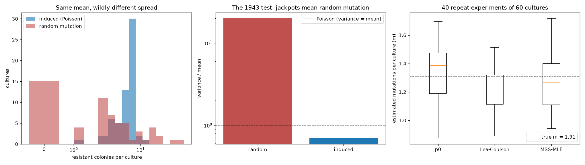

# Luria-Delbrück Fluctuation Test

> Some cultures have no resistant mutants. A few have dozens. That variance helped win a Nobel Prize.

## Demo Output



Produced by simulation in `demo.py`: resistant-colony counts under random mutation and under induced resistance, their variance-to-mean ratios, and mutation-rate estimates from three methods across 40 repeat experiments.

## Why This Exists

In 1943 Luria and Delbrück asked whether bacteria become resistant *because* they meet a virus, or whether resistance mutations arise at random beforehand. Both ideas predict the same average. Only random mutation predicts "jackpots": a mutation early in a culture's growth leaves a huge clone. The fluctuation test is still how mutation rates are measured, and the estimator matters, because the Luria-Delbrück distribution has a tail heavy enough to wreck naive averages.

## Estimators

| Method | Uses | Strength | Weakness |
|--------|------|----------|----------|
| p0 method | Fraction of cultures with zero mutants | Ignores jackpots | Only works when m is about 0.3-2.3 |
| Lea-Coulson median | Median count | Simple and robust | Biased when m is small |
| MSS maximum likelihood | The full distribution (Ma-Sandri-Sarkar recursion) | Most efficient; recommended | Needs computation (here, 30 lines) |

```python
from fluctuation import m_mss_mle
m = m_mss_mle(colony_counts)
rate = m / cells_per_culture
```

## When NOT to Use This

- **Plating efficiency below 1, or phenotypic lag.** Adjust m (see Rosche & Foster) before converting it to a rate.
- **Mutants that grow slower than wild type** bias every estimator here, which all assume equal growth.
- **Never average the counts.** The mean of a Luria-Delbrück sample is dominated by whichever jackpot you happened to get.

## The Uncomfortable Truth

Mutation rates computed as "mutants / total cells" can be off by orders of magnitude. If a paper doesn't name its estimator, assume the number is shaky.

## Further Reading

- Luria S. E. & Delbrück M. "Mutations of bacteria from virus sensitivity to virus resistance." Genetics (1943).
- Lea D. E. & Coulson C. A. "The distribution of the numbers of mutants in bacterial populations." Journal of Genetics (1949).
- Rosche W. A. & Foster P. L. "Determining mutation rates in bacterial populations." Methods (2000).
